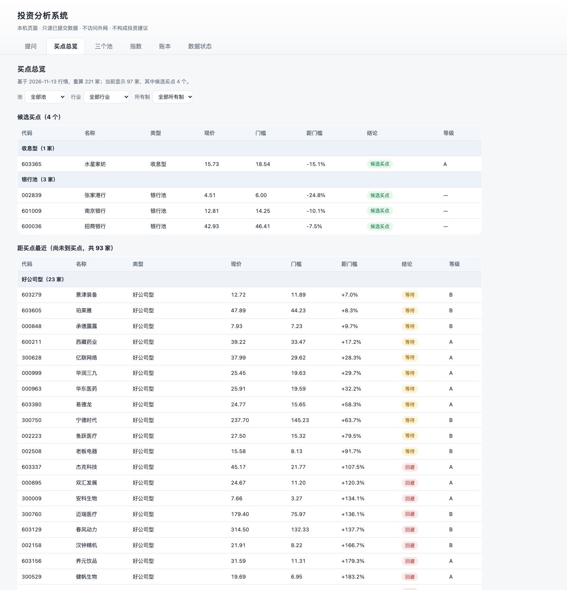

# investment-system

一个**规则化**的 A 股价值投资分析引擎：先按规则筛出「好公司」，再按已批准的估值规则判断现在离买点有多远。

覆盖范围：A 股个股、三类股票池（好公司型 / 收息型 / 银行池）、境内宽基指数、境内普通被动 ETF。

> **免责声明**：本项目是个人研究工具，所有输出**不构成投资建议**。规则、参数和数据都可能有错或过时，据此投资的盈亏由使用者自负。



## 特点

- **规则化，不调用大模型**：所有结论都由「已批准的规则 + 已提交的固定数据」算出，同样的输入永远得到同样的结果，每个数字都能复核。
- **先分类，再下结论**：每只股票先标注属于哪一类（好公司型 / 收息型 / 银行池 / 池外），再按对应规则估值。
- **只做前向验证**：不用历史回测调参数；结论账本只追加、不修改，到期统一复盘。
- **持续监测**：每周扫描「红线事件」（立案、处罚、公开谴责、审计意见不干净、大股东质押超过一半），命中即剔除出池；财报季自动更新。
- **克制**：指数和 ETF 只展示研究信号，不给买卖判断；券商、保险不做。

## 环境要求

- macOS 或 Linux（每日自动更新只支持 macOS 的 launchd；Linux 可以手动运行或自己配 cron）
- Python 3.12（最低 3.11）
- 取数需要联网（数据来自 [AKShare](https://github.com/akfamily/akshare) 和交易所、上市公司公开信息）；只看已提交的数据可以完全离线

## 安装

```bash
git clone https://github.com/comyn6659-tech/investment-system.git
cd investment-system

# 虚拟环境必须建在项目根目录、名字必须是 .venv（入口脚本会用 .venv/bin/python）
python3.12 -m venv .venv
.venv/bin/python -m pip install -r requirements-data.txt
.venv/bin/python -m pip install pytest==9.2.0    # 可选：跑测试用
```

## 快速开始

以下命令都在项目根目录执行：

```bash
./ask "招商银行怎么样"                     # 输出一张分析卡片
./ask --detail "茅台怎么样"                # 展开估值细节
./ask --no-update "沪深300 现在什么位置"    # 不联网，只用已提交的数据
./ask "最近有什么变动"                     # 最近一年的出池、结论变化、财报更新
./web                                     # 打开本机网页（只监听 127.0.0.1）
./update                                  # 手动刷新行情与前向记录（联网）
```

每日自动更新（仅 macOS）：

```bash
scripts/install-daily-update.sh --dry-run   # 先看看会装什么
scripts/install-daily-update.sh             # 安装
scripts/uninstall-daily-update.sh           # 卸载
```

## 文档

| 文档 | 内容 |
|---|---|
| [docs/使用说明.md](docs/使用说明.md) | 支持的问法、卡片怎么读、五种类型、四种结论的含义 |
| [docs/规则说明.md](docs/规则说明.md) | 全部估值与选池规则、参数、已知局限 |
| [docs/维护说明.md](docs/维护说明.md) | 每日更新、年度重跑股票池、定期更新假设、出错处理 |

开发过程中的历史记录在 [docs/archive/](docs/archive/)，变更明细见 git 提交历史。

## 目录结构

```text
engine/        运行时代码（不联网取数、不调用大模型）
engine/web/    本机网页（标准库 http.server + 静态页面）
data/          已提交的固定数据：快照、政策、账本、注册表、行情序列
tools/         取数、建快照、年度重跑、验收与报告工具（需要时才联网）
tests/         离线测试
docs/          使用、规则、维护三份文档；archive/ 为历史记录
scripts/       归档验证、账本校验、每日更新安装
examples/      示例请求与输出
ask / update / web   三个入口脚本
```

运行时只读取已提交的快照与政策，不读 `data/cache/` 等被 git 忽略的缓存。

## 测试

```bash
PYTHONDONTWRITEBYTECODE=1 .venv/bin/python -m pytest -q -p no:cacheprovider
```

全部测试离线运行；在非 macOS 系统上，launchd 相关的 2 项会自动跳过。

## 许可证

[MIT](LICENSE)
