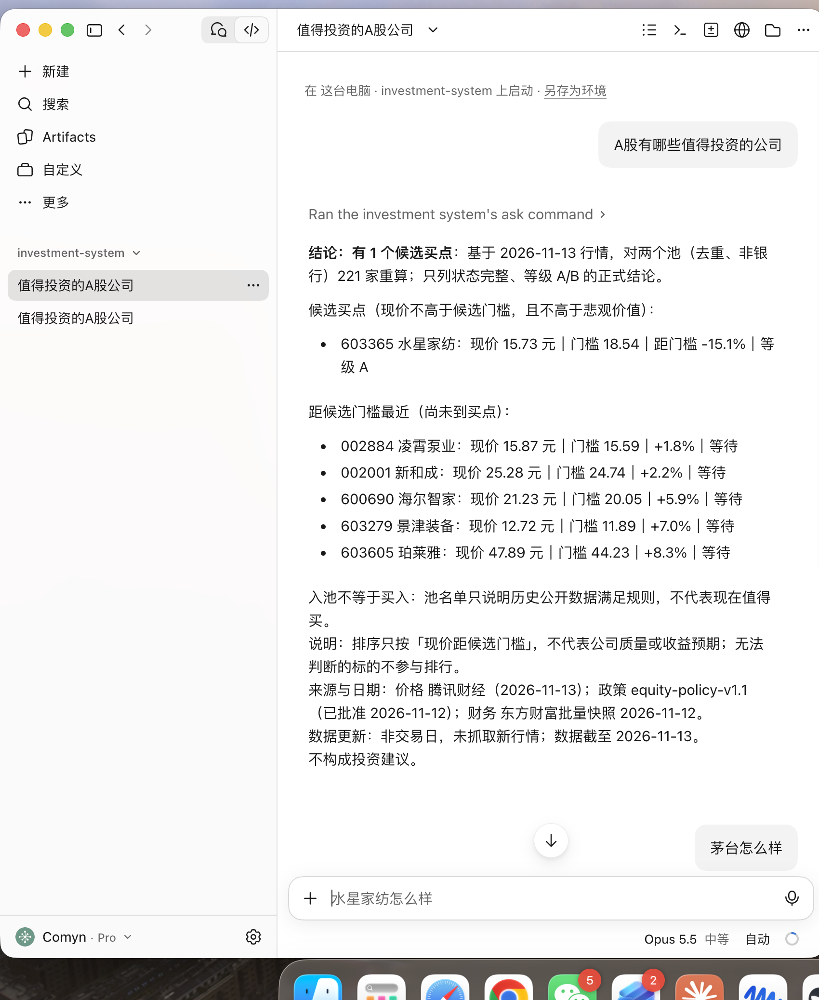
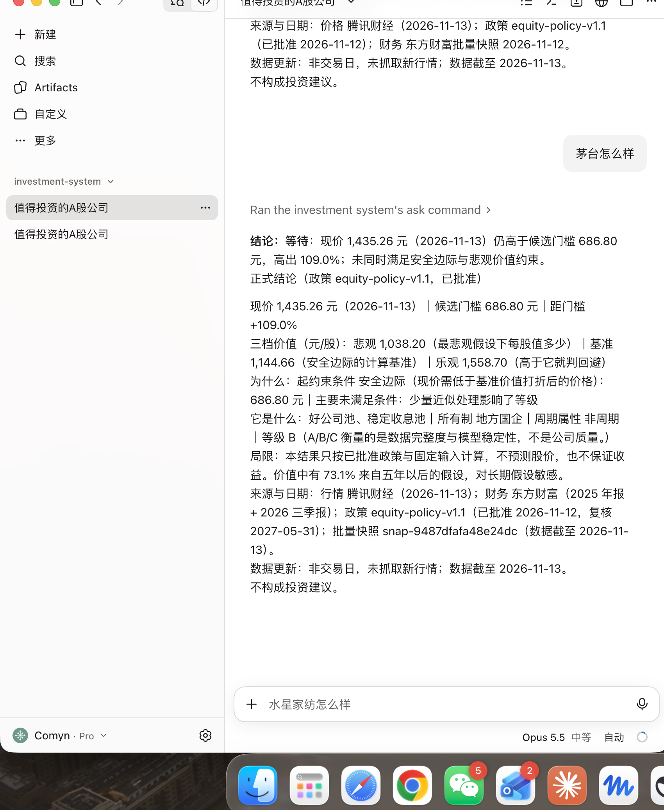

# Claude Code 新会话验证（W1）

- 日期：2026-11-14 15:39（Asia/Singapore）
- 会话：Claude Code，新会话，项目目录 `investment-system`
- 会话记录：`~/.claude/projects/-Users-comyn-Documents-deepseek-harness----investment-system/f166b587-c06b-4571-9942-8c19595c19c0.jsonl`
- 证据截图：`docs/evidence/claude-code-q1.png`、`docs/evidence/claude-code-q2.png`

## 问题 1：A股有哪些值得投资的公司

Claude Code 实际执行的命令（会话记录中的 Bash 调用）：

```bash
cd "/Users/comyn/Documents/deepseek-harness/投资/investment-system" && ./ask "A股有哪些值得投资的公司"
```

命令返回的卡片（节选）：

```markdown
**结论：有 1 个候选买点** — 基于 2026-11-13 行情，对两个池（去重、非银行）221 家重算；只列状态完整、等级 A/B 的正式结论。
...
入池不等于买入：池名单只说明历史公开数据满足规则，不代表现在值得买。
...
数据更新：非交易日，未抓取新行情；数据截至 2026-11-13。
不构成投资建议。
```

截图：

## 问题 2：茅台怎么样

Claude Code 实际执行的命令：

```bash
cd "/Users/comyn/Documents/deepseek-harness/投资/investment-system" && ./ask "茅台怎么样"
```

命令返回的卡片（节选）：

```markdown
**结论：等待** — 现价 1,435.26 元（2026-11-13）仍高于候选门槛 686.80 元，高出 109.0%；未同时满足安全边际与悲观价值约束。
正式结论（政策 equity-policy-v1.1，已批准）
...
它是什么：好公司池、稳定收息池｜所有制 地方国企｜周期属性 非周期｜等级 B（A/B/C 衡量的是数据完整度与模型稳定性，不是公司质量。）
...
数据更新：非交易日，未抓取新行情；数据截至 2026-11-13。
不构成投资建议。
```

截图：

## 说明

- `CLAUDE.md` 已放在项目根目录，Claude Code 新会话会自动读取；两次提问都只调用了 `./ask`，
  没有用模型自身知识回答，也没有补充买卖意见。
- 截图已裁剪为 Claude Code 窗口，不含其他应用内容。
- 卡片内容由 Claude Code 按 Markdown 渲染；原始命令输出可用 `./ask "<问题>"` 复核。
- 本次新会话产生 1 条正式结论记录（茅台，分析日 2026-11-14）；账本旧记录不变。
